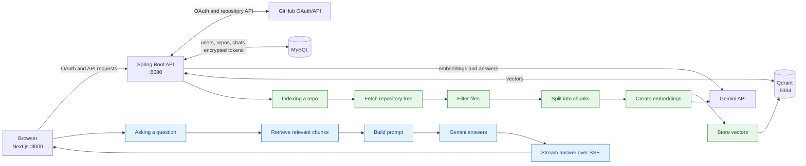

# GitPilot 🚀

GitPilot is a full-stack app for signing in with GitHub, indexing your repositories, and chatting with their code using retrieval-augmented generation.

[](https://www.java.com/)
[](https://spring.io/projects/spring-boot)
[](https://nextjs.org/)
[](https://www.mysql.com/)
[](https://qdrant.tech/)

## What is GitPilot?

GitPilot connects to GitHub with OAuth and fetches repositories the signed-in user can access. It filters and chunks repository files, creates vector embeddings, and stores them in Qdrant. When the user asks a question, GitPilot retrieves relevant code and sends it to Gemini. The response is streamed to the browser over Server-Sent Events (SSE).

### Features

- GitHub OAuth sign-in and session-based authentication
- Repository syncing from the GitHub API
- Repository indexing with progress and error status
- File filtering for common source, configuration, documentation, and markup files
- Code search using Qdrant similarity retrieval
- Chat sessions and persisted chat messages
- File citations in assistant responses
- Live token-by-token chat streaming over SSE
- Encrypted GitHub access tokens stored in MySQL

## How it works (behind the scenes) 🧭



1. The user logs in with GitHub OAuth.
2. The backend fetches repositories through the GitHub API.
3. Indexing filters files, excluding generated/dependency directories, lock files, hidden files, unsupported extensions, and files over 102,400 bytes.
4. Files are split with Spring AI's token splitter. The configured chunk size is 800 characters, converted by the code to 200 tokens. `app.indexing.chunk-overlap=100` is present in configuration, but the current `CodeChunker` does not pass an overlap value to the splitter.
5. Chunks use Google GenAI's embedding model selected by Spring AI's `DEFAULT_MODEL_NAME` and are stored in the Qdrant collection `eazybytes`.
6. The user asks a question. GitPilot retrieves the top 8 matching chunks for that repository.
7. A prompt containing the retrieved code context and question is built.
8. Gemini `gemini-3.5-flash-lite` generates the answer.
9. The answer is streamed to the browser over SSE.

## Tech stack

| Layer | Technology | Purpose |
|---|---|---|
| Frontend | Next.js 16, React 19, TypeScript | Browser UI and SSE client |
| Backend | Java 17, Spring Boot 4.1.1, Spring AI 2.0.0 | OAuth, repository sync, indexing, RAG, and chat APIs |
| Database | MySQL | Users, repositories, chat sessions, messages, and encrypted GitHub tokens |
| Vector DB | Qdrant | Embedded code chunks and similarity search |
| AI | Google Gemini via Spring AI | Code embeddings and streamed answers |
| Auth | GitHub OAuth 2.0 and Spring Security sessions | Sign-in and authenticated API access |

## Project structure

```text
backend/     Spring Boot API, services, entities, and configuration
frontend/    Next.js application and UI components
docs/        Reusable architecture documentation
compose.yml  Qdrant Docker Compose service
```

## Getting started

### Prerequisites

- Java 17
- Node.js 20 or newer
- Docker
- MySQL with a `gitPilot` database

1. Clone the repository and enter it:

   ```bash
   git clone https://github.com/Yaswant2006/gitPilot.git
   cd gitPilot
   ```

2. Create a GitHub OAuth App. Use:
   - Homepage URL: `http://localhost:3000`
   - Authorization callback URL: `http://localhost:8080/login/oauth2/code/github`

3. Create a Gemini API key.

4. Set the environment variables listed below. Do not commit real keys or passwords.

5. Start Qdrant and MySQL. The included `compose.yml` starts Qdrant; MySQL must be running separately:

   ```bash
   docker compose up -d
   ```

6. Run the backend on port 8080:

   ```bash
   cd backend
   ./mvnw spring-boot:run
   ```

7. In another terminal, run the frontend on port 3000:

   ```bash
   cd frontend
   npm install
   npm run dev
   ```

8. Open [http://localhost:3000](http://localhost:3000).

## Environment variables

| Variable | Description | Fake example |
|---|---|---|
| `DB_USERNAME` | MySQL username | `gitpilot_user` |
| `DB_PASSWORD` | MySQL password | `not-a-real-password` |
| `GITHUB_CLIENT_ID` | GitHub OAuth App client ID | `Iv1.fakeclientid` |
| `GITHUB_CLIENT_SECRET` | GitHub OAuth App client secret | `fake-github-secret` |
| `FRONTEND_URL` | Frontend URL used after OAuth | `http://localhost:3000` |
| `CORS_ALLOWED_ORIGINS` | Allowed browser origins | `http://localhost:3000` |
| `TOKEN_ENCRYPTOR_PASSWORD` | Password used to encrypt GitHub access tokens | `fake-token-password` |
| `TOKEN_ENCRYPTOR_SALT` | Salt used by the token encryptor | `deadbeefcafebabe` |
| `api_key` | Gemini API key | `fake-gemini-key` |
| `NEXT_PUBLIC_API_BASE_URL` | Optional frontend backend URL; defaults to `http://localhost:8080` | `http://localhost:8080` |

The backend reads these values from environment-variable placeholders in `backend/src/main/resources/application.properties`. The frontend reads `NEXT_PUBLIC_API_BASE_URL` at build/runtime.

## API overview

All `/api/**` endpoints require an authenticated session unless noted otherwise.

| Method | Path | Purpose |
|---|---|---|
| GET | `/api/auth/login-url` | Return the GitHub OAuth login path |
| GET | `/api/auth/me` | Return the current user |
| POST | `/api/auth/logout` | End the session |
| GET | `/api/repos?refresh={true\|false}` | Sync from GitHub or list stored repositories |
| GET | `/api/repos/{id}` | Get one owned repository |
| POST | `/api/repos/{id}/index` | Start asynchronous repository indexing |
| GET | `/api/repos/{id}/status` | Get indexing progress and status |
| POST | `/api/chat/sessions` | Create a chat session for an indexed repository |
| GET | `/api/chat/sessions?repositoryId={id}` | List sessions for a repository |
| GET | `/api/chat/sessions/{id}` | Get messages in a chat session |
| POST | `/api/chat/sessions/{id}/messages` | Send a question and receive an SSE response |

GitHub OAuth starts at `/oauth2/authorization/github` and returns through `/login/oauth2/code/github`.

## Future improvements

- Add incremental indexing with GitHub webhooks.
- Add method-level code chunking.
- Combine vector similarity with hybrid search.
- Add a complete Docker Compose deployment, including MySQL and the application services.

## Acknowledgements

GitPilot uses Spring Boot, Spring AI, Next.js, React, MySQL, Qdrant, GitHub OAuth, and the Gemini API.

## License

No license file is currently included in this repository.

## Details to verify

- The exact embedding model name is not declared in this repository; the code uses Spring AI's `GoogleGenAiTextEmbeddingOptions.DEFAULT_MODEL_NAME`.
- The `DB_PASSWORD` and `TOKEN_ENCRYPTOR_PASSWORD` placeholder names are referenced by configuration keys whose values are not visible in the checked-in properties output; verify those environment names before deployment.
